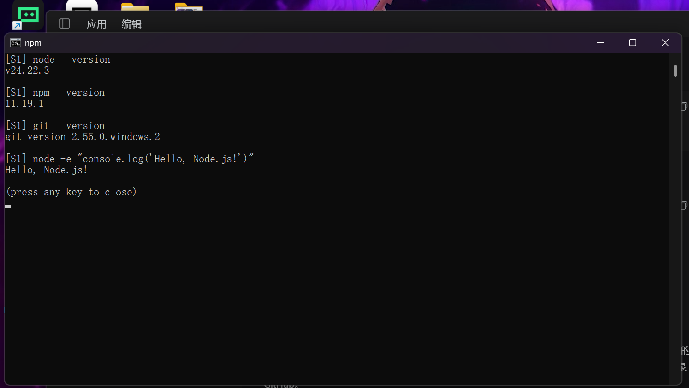
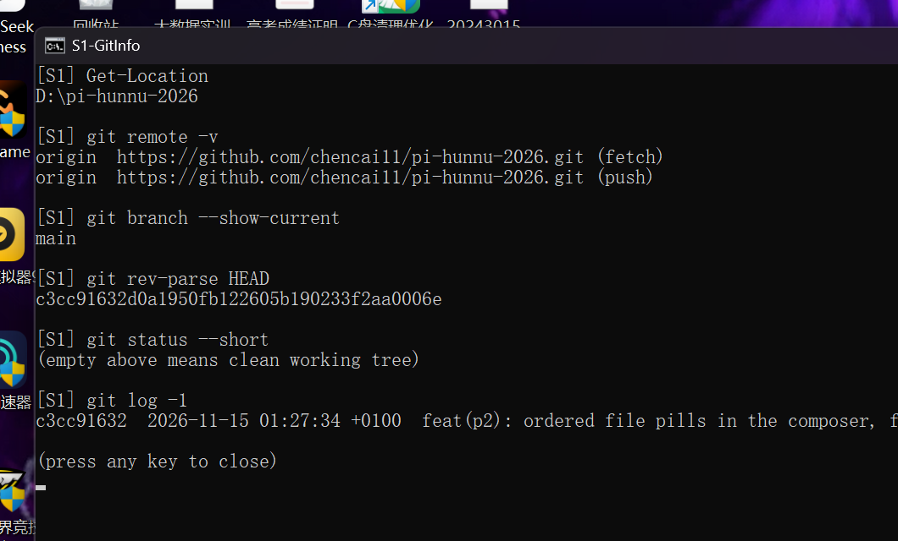
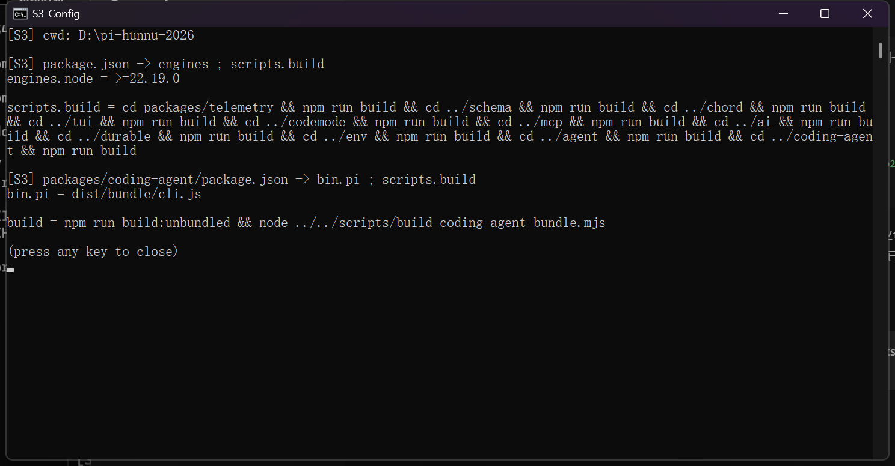
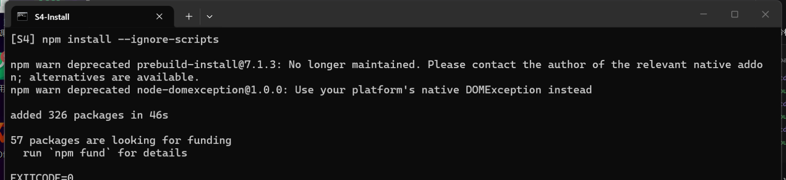
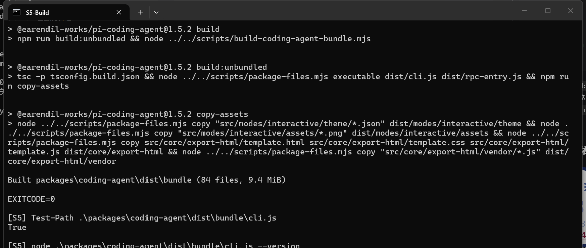
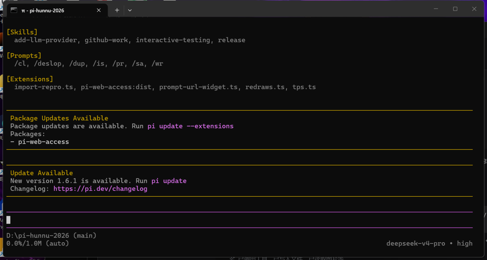
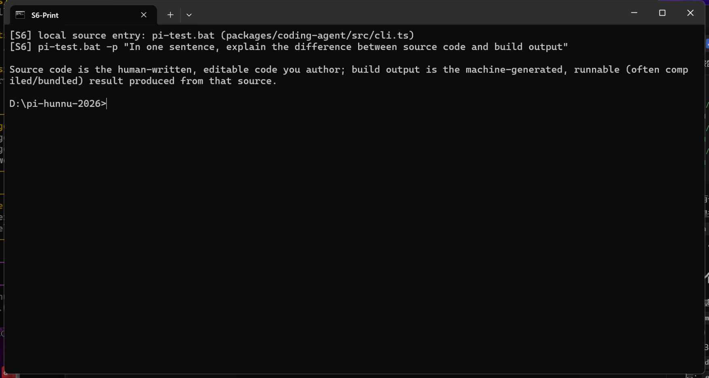

# 实践课 3：Pi Agent 源码安装与编译

> 小组代码仓库：<https://github.com/chencai11/pi-hunnu-2026>
> 本地路径：`D:\pi-hunnu-2026`，分支 `main`，提交 `c3cc91632d0a1950fb122605b190233f2aa0006e`
> 个人报告仓库：<https://github.com/ak4399-ctrl/pi-agent2>
> 姓名 / 学号：祝彬涵 / 202430154156

本次实验的目标是"源码在哪里、依赖装在哪里、构建执行了什么、正在运行哪个版本"四件事。下面按六项任务逐条记录，截图编号与作业要求一致（S1–S6）。

---

## 任务一 实验准备：检查开发工具（S1）

执行：

```powershell
node --version
npm --version
git --version
```

本机结果：

| 工具 | 实际版本 | 说明 |
|---|---|---|
| Node.js | `v24.22.3` | 项目 `engines.node` 要求 `>=22.19.0`；按作业建议使用 24 LTS |
| npm | `11.19.1` | 随 Node.js 24.22.3 附带，未单独安装 |
| Git | `2.55.0.windows.2` | 用于 clone 与版本确认 |

补充：`node -e "console.log('Hello, Node.js!')"` 输出 `Hello, Node.js!`。



**过程说明**：机器上原本装的是 Node.js `v22.23.1`（满足根项目 `>=22.19.0`），但作业提到旧分支依赖 `@earendil-works/gondolin` 声明 `>=23.6.0`，Node 22 会出现 `EBADENGINE` 警告。为了和作业截图（v24.22.3 / npm 11.19.1）一致，我下载了 Node.js 24 LTS 的官方 zip 便携版解压到 `D:\node24`，在每个命令窗口里把它的路径放到 `PATH` 最前面，没有改动系统全局的 Node 版本。

---

## 任务二 下载课程仓库源码（S2）

```powershell
git clone --branch main https://github.com/chencai11/pi-hunnu-2026.git
cd pi-hunnu-2026
Get-Location; git remote -v; git branch --show-current; git rev-parse HEAD; git status --short
```

| 检查项 | 结果 |
|---|---|
| 当前目录 | `D:\pi-hunnu-2026` |
| origin | `https://github.com/chencai11/pi-hunnu-2026.git`（fetch / push） |
| 分支 | `main` |
| HEAD | `c3cc91632d0a1950fb122605b190233f2aa0006e` |
| 工作区 | `git status --short` 为空 |



---

## 任务三 阅读配置，确认安装与编译的依据（S3）

根 `package.json` 中：

```json
"engines": { "node": ">=22.19.0" }
```

`scripts.build` 是一条串行命令，依次进入 11 个子包执行各自的 `npm run build`，`&&` 表示前一步成功才继续：

```
telemetry → schema → chord → tui → codemode → mcp → ai → durable → env → agent → coding-agent
```

CLI 包的入口配置在 `packages/coding-agent/package.json`：`bin.pi = dist/bundle/cli.js`，它的 `build` 是 `build:unbundled && node ../../scripts/build-coding-agent-bundle.mjs`（`tsc` 编译后再用 esbuild 打成一个 bundle）。



**报告问题 1：Node.js 版本要求在哪里？**
在根 `package.json` 的 `engines.node` 字段（`>=22.19.0`），不是 `npmrc`、也不是 CI 脚本；它是 npm 安装时检查 `EBADENGINE` 的依据。

**报告问题 2：`npm run build` 实际从哪里读取命令？**
从根 `package.json` 的 `scripts.build`（npm 脚本表）。npm 本身不内置编译流程，它只是把这段命令交给 shell 执行；真正的编译工具（`tsc`、esbuild、`node catalog/generate.ts`）由各子包的 `scripts.build` 和 `tsconfig.build.json` 决定。

---

## 任务四 安装项目依赖（S4）

在仓库根目录执行（`--ignore-scripts` 跳过安装期的生命周期脚本，不影响后续主动 build）：

```powershell
npm install --ignore-scripts
```

结果：

```
npm warn deprecated prebuild-install@7.1.3: No longer maintained...
npm warn deprecated node-domexception@1.0.0: Use your platform's native DOMException instead

added 326 packages in 46s

57 packages are looking for funding
EXITCODE=0
```



**如何区分警告与错误**：两条 `npm warn deprecated` 是"依赖包已弃用"的提示，不是失败；`npm error` 才会导致非零退出码。这次进程退出码为 `0`，说明安装成功。`node_modules` 体积约 597 MB，是本地重建的依赖目录，不是从仓库里下载的（`node_modules` 不在版本控制里）。

---

## 任务五 本地编译与构建产物验证（S5）

```powershell
npm run build
Test-Path .\packages\coding-agent\dist\bundle\cli.js
node .\packages\coding-agent\dist\bundle\cli.js --version
```

结果：

```
Built packages\coding-agent\dist\bundle (84 files, 9.4 MiB)
EXITCODE=0

[S5] Test-Path .\packages\coding-agent\dist\bundle\cli.js
True

[S5] node .\packages\coding-agent\dist\bundle\cli.js --version
1.5.2
```



说明：`EXITCODE=0` 是**整条根构建链**的退出码（不是某个子包的）；`Test-Path` 返回 `True` 证明产物存在；`--version` 输出 `1.5.2`，与仓库各包版本号一致，说明跑的是刚构建出来的这份产物。首次构建会联网获取"模型目录"配置数据（不是下载模型权重）；数据准备好之后可以用 `npm run build:offline` 复用这份数据重新编译。

---

## 任务六 启动本地源码版本并完成一次会话（S6）

### 1. 验证源码入口

```powershell
.\pi-test.bat --version
```

输出 `1.5.2`。这个 `.bat` 会调用同名 `.ps1`，由 Node.js 加载 TypeScript 源码解析器并直接运行 `packages/coding-agent/src/cli.ts`——它运行的是**源码**，不是 `dist`，也不是第一次实践课全局安装的 `pi`。

### 2. 启动界面

```powershell
.\pi-test.bat
```

界面正常启动，标题栏显示 `π - pi-hunnu-2026`，状态栏显示当前目录 `D:\pi-hunnu-2026 (main)`、模型 `deepseek-v4-pro`，并列出已加载的 skills / prompts / extensions。由于第一次实践课已经登录过，配置目录 `~/.pi/agent` 里的凭据仍然有效，无需重新 `/login`。



### 3. 一次真实会话

向本地源码版发一句提示词并收到回复：

```powershell
pi-test.bat -p "In one sentence, explain the difference between source code and build output"
```

```
Source code is the human-written, editable code you author; build output is the
machine-generated, runnable (often compiled/bundled) result produced from that source.
```



**报告问题 3：本次如何确保运行的是本地源码？**
① 命令用的是仓库根目录的 `.\pi-test.bat`，它解析并执行 `packages/coding-agent/src/cli.ts`，不读 `dist`、也不查找全局 `pi`；② 终端当前目录就是 `D:\pi-hunnu-2026`，状态栏也显示同一路径；③ `--version` 输出 `1.5.2`，与本地仓库 `packages/*/package.json` 的版本一致。

**报告问题 4：源码入口与 `dist/bundle/cli.js` 入口分别适合什么场景？**

| 入口 | 适合场景 | 原因 |
|---|---|---|
| `pi-test.bat`（`src/cli.ts`） | 开发调试：改完 `src` 立刻再跑，无需构建 | 由 Node 直接执行 TS 源码，能立刻看到修改效果；代价是启动慢一些、依赖开发期工具 |
| `node dist/bundle/cli.js` | 验证构建产物、发布前回归、日常使用 | 是 `npm run build` 的最终产物，启动快、依赖完整；但它只反映"上一次构建"，改源码后不重新构建就看不到效果 |

---

## 遇到的困难与解决（重点）

1. **直连 GitHub 被重置**：`git clone` 报 `Recv failure: Connection was reset`，`curl https://github.com` 返回 `000`。
   解决：本机 Clash Verge 在 `127.0.0.1:7897` 提供混合代理，给 git 设置 `HTTP(S)_PROXY` 后即可克隆。

2. **git 的 TLS 后端报错**：`schannel: AcquireCredentialsHandle failed: SEC_E_NO_CREDENTIALS (0x8009030e)`。
   解决：给该次命令加 `-c http.sslBackend=openssl`，绕过 Windows schannel 的凭据问题；这是本机环境的偶发问题，不是仓库问题。

3. **Node 版本与依赖声明不一致**：Node 22.23.1 满足根项目 `>=22.19.0`，但部分工作区依赖要求更高版本。
   解决：改用 Node.js 24 LTS（官方 zip 便携版），把 `D:\node24\node-v24.22.3-win-x64` 放到 `PATH` 最前，不改动系统全局安装。

4. **npm 不走系统代理**：默认 registry 直连会超时。
   解决：安装时设置 `npm_config_proxy` / `npm_config_https_proxy` 指向同一个本地代理端口。

5. **批处理脚本里写中文会乱码并中断**：cmd 按 GBK 解析 UTF-8 脚本，导致命令被截断。
   解决：把批处理脚本改成纯 ASCII，中文说明放到 Markdown 报告里。

6. **截图的坑**：Windows 终端窗口标题会被 npm 改写、控制台句柄与 DPI 缩放不一致，导致截图截到桌面或被其它窗口遮挡。
   解决：改用 `GetConsoleWindow()`、`SetProcessDPIAware()` 并在截图前把窗口置顶、按物理像素裁剪；必要时先 `title` 复位标题再截图。

---

## 结论

- **源码在哪里**：`D:\pi-hunnu-2026`（小组组织仓库的 fork，`main` @ `c3cc9163…`）。
- **依赖装在哪里**：仓库根目录的 `node_modules`（约 597 MB），由 `npm install --ignore-scripts` 按 `package-lock.json` 安装。
- **构建执行了什么**：根 `scripts.build` 串行进入 11 个子包，各自 `tsc -p tsconfig.build.json`（`ai` 还先生成模型目录、`coding-agent` 最后用 esbuild 打包），最终产物是 `packages/coding-agent/dist/bundle/cli.js`。
- **正在运行哪个版本**：`1.5.2`，来自本地源码（`pi-test.bat`）与本地产物（`node dist/bundle/cli.js`）两条路径都已验证。
