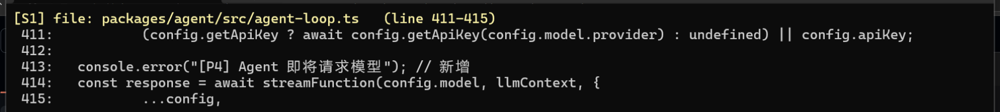
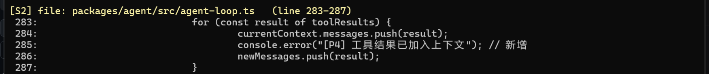
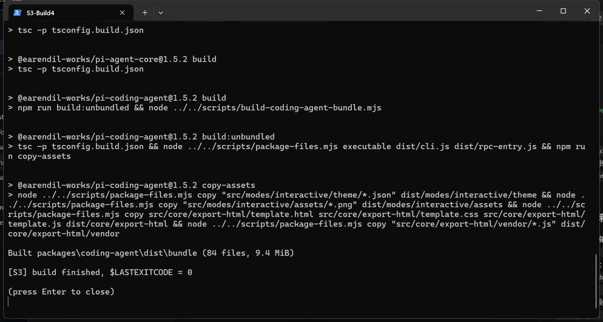
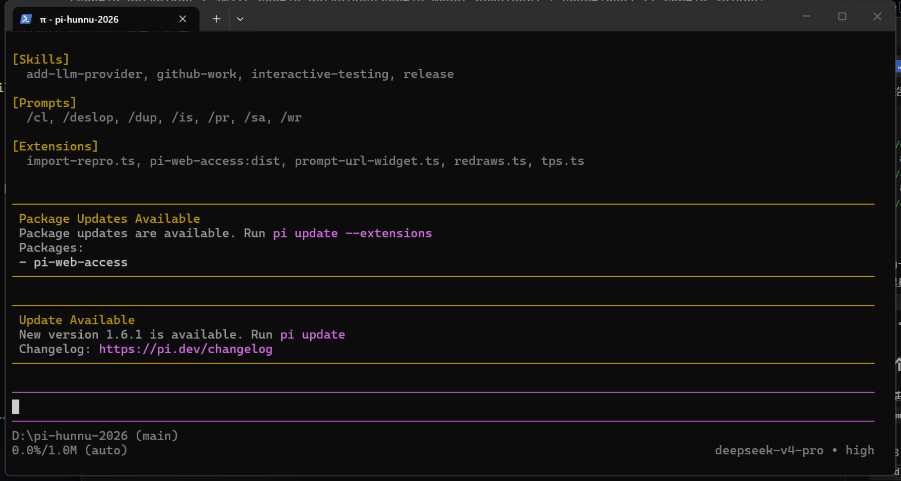
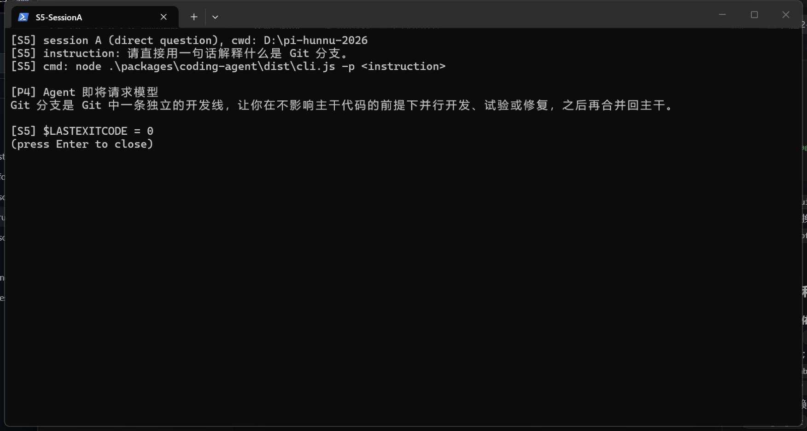
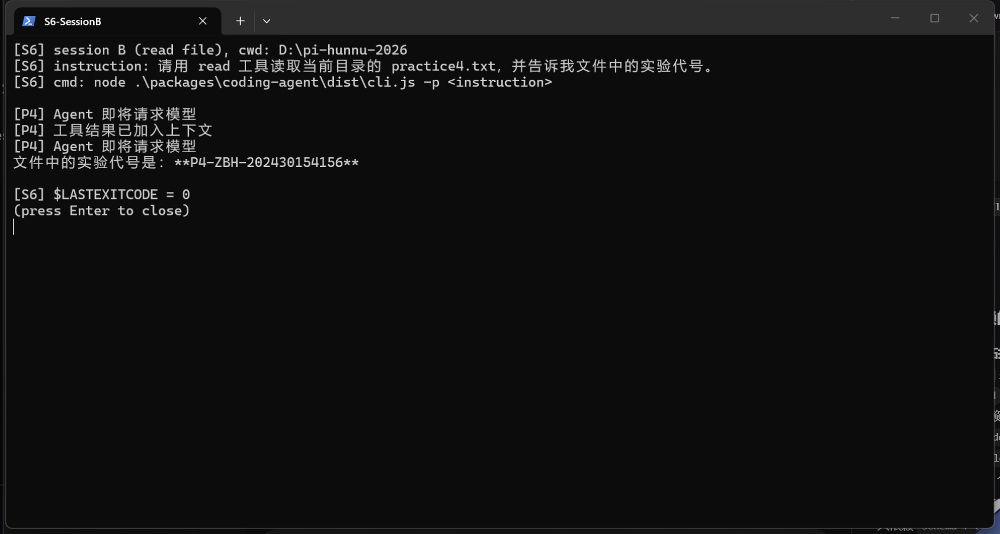
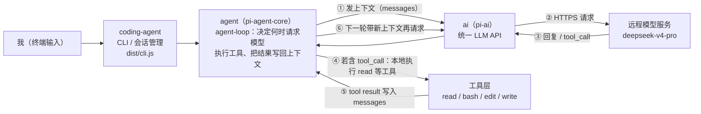

# 实践课 4：Pi Agent 的模型调用与运行流程

> 小组代码仓库：<https://github.com/chencai11/pi-hunnu-2026>
> 本地路径：`D:\pi-hunnu-2026`，分支 `main`，提交 `c3cc91632d0a1950fb122605b190233f2aa0006e`
> 运行环境：Node.js v24.22.3 / npm 11.19.1，模型 `deepseek-v4-pro`
> 姓名 / 学号：祝彬涵 / 202430154156

本次实验在实践课 3 已构建好的仓库里，给 Agent 循环加两行日志，重新编译后对比"直接问答"和"读取文件"两种会话，观察模型请求与工具结果进入上下文的时序。

---

## 一、源码修改

修改文件：`packages/agent/src/agent-loop.ts`（本组版本行号与作业示例一致：原第 284、412 行）。

### 1.1 修改点一：模型调用前（原第 412 行上方）

```ts
	console.error("[P4] Agent 即将请求模型"); // 新增
	const response = await streamFunction(config.model, llmContext, {
		...config,
		apiKey: resolvedApiKey,
```

### 1.2 修改点二：工具结果写入上下文后（原第 284 行下方）

```ts
				for (const result of toolResults) {
					currentContext.messages.push(result);
					console.error("[P4] 工具结果已加入上下文"); // 新增
					newMessages.push(result);
				}
```

### 1.3 完整 diff

```diff
--- a/packages/agent/src/agent-loop.ts
+++ b/packages/agent/src/agent-loop.ts
@@ -282,6 +282,7 @@ async function runLoop(
 				for (const result of toolResults) {
 					currentContext.messages.push(result);
+					console.error("[P4] 工具结果已加入上下文"); // 新增
 					newMessages.push(result);
 				}
 			}
@@ -409,6 +410,7 @@ async function streamAssistantResponse(
 	const resolvedApiKey =
 		(config.getApiKey ? await config.getApiKey(config.model.provider) : undefined) || config.apiKey;
 
+	console.error("[P4] Agent 即将请求模型"); // 新增
 	const response = await streamFunction(config.model, llmContext, {
 		...config,
 		apiKey: resolvedApiKey,
```

插入后行号：`console.error("[P4] 工具结果已加入上下文")` 在第 **285** 行，`console.error("[P4] Agent 即将请求模型")` 在第 **413** 行。





---

## 二、重新编译与启动

### 2.1 构建

```powershell
npm run build
$LASTEXITCODE
```

构建链跑完 11 个子包，最后 `Built packages\coding-agent\dist\bundle (84 files, 9.4 MiB)`，`$LASTEXITCODE = 0`。



### 2.2 启动编译产物

```powershell
node .\packages\coding-agent\dist\cli.js
```



> 说明：为了能在一屏内看清 `[P4]` 日志的顺序（TUI 会与 stderr 日志混排、且会重绘），两次会话改用同一程序的非交互模式 `-p` 运行：`node .\packages\coding-agent\dist\cli.js -p "<指令>"`。两者走的是**同一条 agent-loop 代码路径**，日志含义完全相同，只是输出更适合记录。

---

## 三、两次会话对比

准备：在仓库根目录创建 `practice4.txt`，内容为一行实验代号 `P4-ZBH-202430154156`。

### 3.1 会话 A：直接问答

- 指令：`请直接用一句话解释什么是 Git 分支。`



| 观察项 | 结果 |
|---|---|
| 是否调用工具 | 否（只输出 `Agent 即将请求模型`，没有 `工具结果已加入上下文`） |
| `[P4]` 日志（按顺序） | `[P4] Agent 即将请求模型` × 1 |
| 模型调用轮数 | **1 轮** |
| 最终回复 | "Git 分支是 Git 中一条独立的开发线，让你在不影响主干代码的前提下并行开发、试验或修复，之后再合并回主干。" |

### 3.2 会话 B：读取文件

- 指令：`请用 read 工具读取当前目录的 practice4.txt，并告诉我文件中的实验代号。`



| 观察项 | 结果 |
|---|---|
| 是否调用工具 | 是（`read` 读取 `practice4.txt`） |
| `[P4]` 日志（按顺序） | ①`[P4] Agent 即将请求模型` → ②`[P4] 工具结果已加入上下文` → ③`[P4] Agent 即将请求模型` |
| 模型调用轮数 | **2 轮** |
| 最终回复 | "文件中的实验代号是：**P4-ZBH-202430154156**" |

### 3.3 两次的差别

| | 会话 A | 会话 B |
|---|---|---|
| 工具调用 | 无 | 1 次 `read` |
| 模型请求次数 | 1 | 2 |
| 日志形态 | `请求` | `请求 → 工具结果入上下文 → 请求` |
| 回复依据 | 模型自身知识 | 文件内容（代号由工具读入后交给模型） |

---

## 四、运行流程说明

### 4.1 谁实际读了文件？

**`read` 工具**读的，不是模型。链路是：模型在第一次请求里"决定"调用 `read`（返回 tool call）→ `agent-loop` 在本地执行该工具（`executeToolCalls`）→ 工具返回文件内容。日志里 `[P4] Agent 即将请求模型` 出现在**工具执行之前**，`[P4] 工具结果已加入上下文` 出现在**工具执行之后**，这两个时间点之间的那段就是本地工具执行。

### 4.2 下一轮模型请求多带了什么？

多了 `currentContext.messages` 里新压入的那条 **tool result 消息**（`practice4.txt` 的内容，以及 tool call 的 id 等结构）。因为上下文变长了，第二轮请求的输入比第一轮多出"文件内容"这一块，模型才能说出文件里的代号——这也是为什么第二轮之前必须先有一条"工具结果已加入上下文"。

### 4.3 循环结构

```
第 1 轮：Agent 即将请求模型 → 模型返回 tool_call(read practice4.txt)
         → 本地执行 read → 工具结果已加入上下文
第 2 轮：Agent 即将请求模型 → 模型基于上下文作答（不再调工具）
```

会话 A 没有工具调用，所以只走了一轮；会话 B 走满两轮，正好对应日志的 3 行。

### 4.4 模块分工示意



图中 `[P4]` 日志的位置：**①** 处打印"Agent 即将请求模型"，**⑤** 处打印"工具结果已加入上下文"。

---

## 五、结论

- 两行日志分别落在"一轮模型调用的入口"和"一条工具结果进入上下文"这两个位置，位置选得对，日志顺序就能直接读出循环结构。
- 直接问答只有 1 次模型请求；读文件是 2 次，中间夹着一次本地 `read` 执行。
- 工具不是模型"远程执行"的，而是在本地 agent 进程里执行，结果以消息形式追加进上下文，再随下一次请求发给模型。
- 编译产物 `dist/cli.js` 与源码入口 `pi-test.bat` 行为一致（本次全部用编译产物验证），说明改动已进入构建产物。
