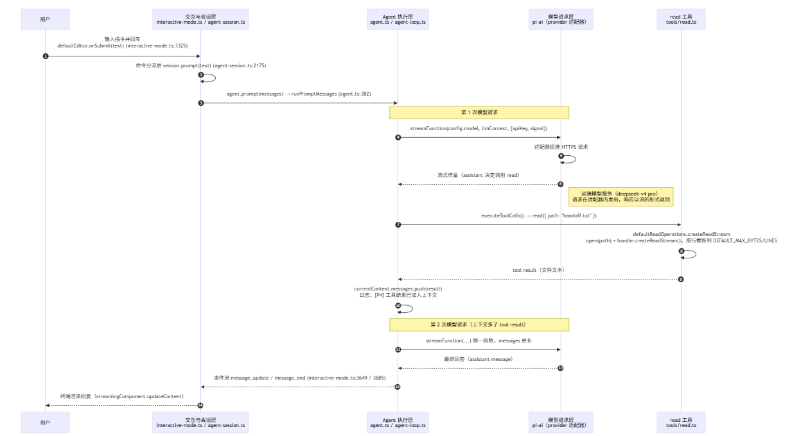
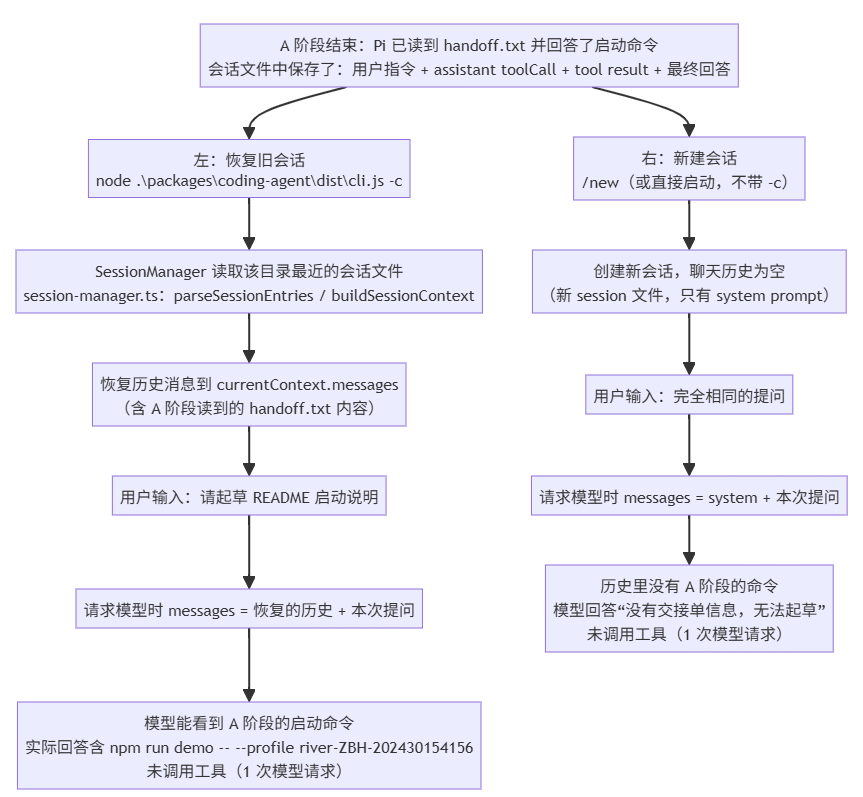

# 实践 05｜Pi Agent 源码泛读与功能定位

> 小组代码仓库：<https://github.com/chencai11/pi-hunnu-2026>（`main` @ `c3cc9163…`）
> 运行环境：Node.js v24.22.3，模型 `deepseek-v4-pro`，使用实践 04 编译出的 `packages/coding-agent/dist/cli.js`
> 姓名 / 学号：祝彬涵 / 202430154156

本报告包含两张图：图 1 是单轮 `read` 工具调用的代码级时序图，图 2 是"恢复旧会话"与"新建会话"的对照流程图。所有标注的函数名、文件名都来自本仓库源码，行号为本组版本实际行号。

---

## A. 单轮交互与工具调用的代码级时序

### A.1 实验设置

在仓库根目录创建 `handoff.txt`（两行，含本组随机标识 `river-ZBH-202430154156`）：

```
待办：补充 README 的启动说明
启动命令：npm run demo -- --profile river-ZBH-202430154156
```

新会话输入（`node .\packages\coding-agent\dist\cli.js -p "..."`）：

> 请用 read 工具读取当前目录的 handoff.txt，原样告诉我待办和启动命令。

实际观测（stderr 的 `[P4]` 日志由实践 04 添加，用来标出模型请求与工具结果入上下文的时刻）：

```
[P4] Agent 即将请求模型
[P4] 工具结果已加入上下文
[P4] Agent 即将请求模型

待办：补充 README 的启动说明
启动命令：`npm run demo -- --profile river-ZBH-202430154156`
```

即：**2 次模型请求 + 1 次工具执行**，工具确实读到了文件。

### A.2 图 1：单轮工具调用时序图（五条生命线）



可编辑图源：[fig1.mmd](fig1.mmd)

**每条生命线对应的源码位置：**

| 时序步骤 | 源码位置 | 说明 |
|---|---|---|
| 用户输入回车 | `packages/coding-agent/src/modes/interactive/interactive-mode.ts:3325` | `this.defaultEditor.onSubmit = async (text) => {...}`，先做斜杠命令分流 |
| 交给会话层 | `interactive-mode.ts:3494` | `await this.session.prompt(text)` |
| 会话层入口 | `packages/coding-agent/src/core/agent-session.ts:2175` | `async prompt(text, options)`，负责模板展开、扩展命令、上下文预检 |
| 启动 Agent 循环 | `packages/agent/src/agent.ts:382` | `async prompt(input) → normalizePromptInput() → runPromptMessages()` |
| 模型请求 | `packages/agent/src/agent-loop.ts:414` | `const response = await streamFunction(config.model, llmContext, {...})` |
| 适配器来源 | `packages/agent/src/agent.ts:244` | `this.streamFunction = runtimeOptions.streamFn ?? getDefaultStreamFn()`，由 `pi-ai` 提供 provider 适配 |
| 工具执行 | `agent-loop.ts` 的 `executeToolCalls()` | 调用 `read` 工具（`createReadToolDefinition`） |
| 文件读取实现 | `packages/coding-agent/src/core/tools/read.ts:76-88` | `readLocalFileChunks()`：`fsOpen(path,"r")` 后 `handle.createReadStream({end, autoClose:false})`，**流式读取**，只保留要显示的行，超过 `DEFAULT_MAX_BYTES/DEFAULT_MAX_LINES` 由 `truncate.ts` 截断（并非一次性 `readFile` 缓冲整文件；`readFile` 只作为无 `createReadStream` 时的兜底） |
| 结果入上下文 | `agent-loop.ts:285` | `currentContext.messages.push(result)`，紧接着打印 `[P4] 工具结果已加入上下文` |
| 回复显示 | `interactive-mode.ts:3649`（`message_update`）/ `:3685`（`message_end`） | `this.streamingComponent.updateContent(this.streamingMessage, true)` 逐字刷新；`message_end` 时落定消息 |

**模型请求层与远端模型**：`streamFunction` 内部由 `pi-ai` 的 provider 适配器把 `{model, messages, tools, apiKey, signal}` 组装成 HTTPS 请求发给远端模型服务（本机为 `deepseek-v4-pro`），响应以 SSE/流的形式返回，`agent-loop` 消费增量后再决定"继续调工具"还是"结束本轮"。图中该边界用 `M` 生命线上的自调用 + 注释标出。

**为什么是两轮**：第 1 轮模型只返回 `toolCall(read, handoff.txt)`；工具在本地执行完、结果写进 `messages` 之后，第 2 轮请求把这份文件内容一起带上，模型才能原样复述两行内容。

---

## B. 恢复旧会话 vs 新建会话

### B.1 实验设置

A 阶段结束后（`handoff.txt` 已读入会话），分别执行：

1. **恢复**：`node .\packages\coding-agent\dist\cli.js -c -p "<同一个问题>"`
   （`-c` 是 `--continue`，等价于 TUI 里"接着上次会话"；TUI 中直接回车继续）
2. **新建**：`node .\packages\coding-agent\dist\cli.js -p "<同一个问题>"`（不带 `-c`，等价于 TUI 里的 `/new` 之后提问）

同一个问题：

> 接着上次的待办，给 README 起草一条启动说明，写出交接单里的完整启动命令。只用这次会话已有的信息。不要调用工具。如果缺少命令，请直接说明。

### B.2 实际结果

| | 恢复旧会话（`-c`） | 新建会话（不带 `-c`） |
|---|---|---|
| `[P4]` 日志 | `Agent 即将请求模型` ×1 | `Agent 即将请求模型` ×1 |
| 是否调用工具 | 否 | 否 |
| 是否出现命令 | **出现** `npm run demo -- --profile river-ZBH-202430154156` | 未出现 |
| 回答摘要 | "启动说明草稿……运行 demo：`npm run demo -- --profile river-ZBH-202430154156`……本次会话只有交接单里的待办和启动命令……" | "我这边没有这次会话里可用的交接单或启动命令信息……请把交接单内容（或其中的启动命令）贴过来……" |

两次都只有 1 次模型请求、都没调用工具，**差别只在于发给模型的 messages 里有没有 A 阶段的历史**：恢复的那次带上了 A 阶段读到的文件内容，新建的那次没有。

### B.3 图 2：两条分支的对照流程图



可编辑图源：[fig2.mmd](fig2.mmd)

**图中涉及的关键实现**：

- 恢复：`packages/coding-agent/src/core/session-manager.ts` 的 `parseSessionEntries()`、`buildSessionContext()` 把会话文件里的条目还原成消息数组，再作为 `currentContext.messages` 的初值；因此"历史消息 + 本次提问"一起进入 `streamFunction`。
- 新建：`AgentSession` 以空历史创建新 session 文件（只有 system prompt），`messages` 只有本次提问，模型自然看不到 A 阶段的命令。

---

## C. 结论

1. **功能入口**确实在 `interactive-mode.ts` 的 `defaultEditor.onSubmit`，它把文本交给 `AgentSession.prompt`，后者调用 `Agent.prompt` 进入 `agent-loop`。
2. **模型与文件的边界**在 `agent-loop.ts:414` 的 `streamFunction(...)`：模型只负责"决定调用哪个工具、传什么参数"，真正的文件读取由本地 `read` 工具完成，且是**流式**读取（`createReadStream` + 截断上限），不是整文件缓冲。
3. **回复显示**在 `interactive-mode.ts` 的 `message_update`/`message_end` 分支，`message_update` 负责流式刷新，`message_end` 负责落定。
4. **会话恢复**本质是把上次的会话文件还原成 `messages` 的初值；`-c`（或 TUI 的继续）与 `/new` 的差别就在这里——这也解释了 B 阶段两次回答的差异。
